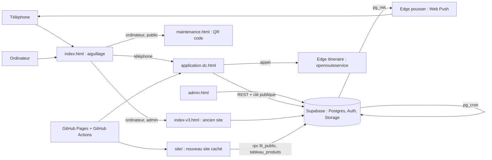

# Architecture de Marché de Gros CI

État relevé le 24/10/2026, sur la branche `main` (commit `2fdc445`) et en direct dans la base de production (lecture du catalogue seulement).

Ce document décrit ce qui existe. Les fonctions prévues sont dans `ROADMAP.md`. L'état de chaque fonction est dans `FONCTIONNALITES.md`.

Aucune clé, aucun jeton, aucun mot de passe n'est recopié ici.

## 1. Vue d'ensemble

En une phrase : des pages statiques hébergées gratuitement sur GitHub Pages, qui parlent directement à Supabase (base Postgres, comptes, fichiers) avec la seule clé publique. Toute la sécurité des données est dans la base (RLS et fonctions `security definer`).

## 2. L'application (priorité)

### 2.1 Fichiers

| Rôle | Fichiers |
|---|---|
| Page unique | `application.dc.html` (environ 2 000 lignes) |
| Moteur de gabarits | `support.js` (« dc-runtime », fichier généré, ne pas modifier à la main). Il charge React depuis `vendor/react.production.min.js` et `vendor/react-dom.production.min.js` |
| Gabarits | balises `sc-if`, `sc-for` et `{{ … }}` dans `application.dc.html`, plus le script `type="text/x-dc"` (l. 811) qui contient la classe du composant et le calcul des écrans (`renderVals()`) |
| Socle chargé au démarrage | `v3/nuage.js`, `app/admin-pc.js`, `v3/personnages.js`, `v3/avatar.js`, `app/icones.js`, `app/effets.js`, `app/marque.js`, `app/sac.js`, `app/garanties.js`, `app/toast.js`, `app/theme.js`, `v2/data.js` (catalogue), `app/marche-app.js`, `app/villes.js` |
| Chargés après coup (`defer`) | `app/nuit.js`, `app/stable.js`, `app/vibre.js`, `app/prixmoment.js`, `app/demo-orbite.js`, `app/activite.js` |
| Chargés à la demande (`window.MDGPlus`, l. 39) | guide, astuces, scène, porte, sons, négociation, compte, souffle, notifications, réputation, statuts, messages, aide, alertes, relevé, commandes, tableau, chauffeur, suivi, prix par zone, racheter, approvisionnement, groupes, carte (`app/carte-app.js`, `app/carte-gl.js`), identité, boutique (`v3/boutique.js`, schéma 86) |
| Bibliothèques embarquées (`vendor/`) | React, MapLibre GL, Tesseract (lecture de la pièce d'identité dans le téléphone), qrcode-generator, d3, topojson, GSAP, Lenis, Lucide |
| Police | Jost, fichiers `fonts/*.woff2` dans le dépôt (aucun appel à Google Fonts) |
| Page chauffeur sans compte | `suivi.html` (appels `/rest/v1/rpc/suivi_lien_*` avec la clé publique) |
| Administration | `admin.html` (noindex) avec `v3/nuage.js`, `v3/messages.js`, `v3/admin-transport.js`, `v3/admin-mesures.js`, `v3/admin.js` |

Chaque module expose un objet global : `MDGNuage`, `MDGCompte`, `MDGNegoce`, `MDGMessages`, `MDGCommandes`, `MDGIdentite`, `MDGRep`, `MDGPousse`, etc.

### 2.2 Client Supabase

`v3/nuage.js` est un client maison (appels `fetch` au REST de Supabase, pas de SDK).

- Compte : une adresse construite à partir du numéro (domaine fictif, aucun e-mail envoyé) et un code de 6 chiffres comme mot de passe Supabase Auth.
- Session gardée dans `localStorage` (`mdg-nuage:session`).
- Annonces : `refresh()` lit `annonces_version()`, puis `offres` et `demandes` actives (500 au plus) et `zones`. Relu toutes les 120 s. `sync()` envoie les annonces du téléphone (`on_conflict=user_id,client_id`).
- Le reste passe par des fonctions `rpc`.

### 2.3 Données gardées dans le téléphone

`localStorage` : mes annonces (`mdg-v2:offres`, `mdg-v2:demandes` ; aucune limite dans le téléphone, la limite de 30 annonces actives est posée par la base), cache du serveur (`mdg-nuage:*`), réglages (`mdg-app:theme`, `mdg-sons:reglages`, `mdg-app:vibrations`, `mdg-compte:prefs`), journal des notifications (`mdg-notifs`), drapeau administrateur (`mdg-site:admin`).

### 2.4 Service worker et hors ligne

`sw.js`, cache `mgci-v262` :

- pages, code et manifeste : réseau d'abord, cache si le réseau ne répond pas ;
- fichiers avec `?v=` et images : cache d'abord ;
- tuiles de carte (`s3.amazonaws.com`, `tiles.openfreemap.org`) : cache à part `tuiles-mgci`, 1 500 au plus ;
- le dossier `site/` n'est jamais servi par le service worker (`sw.js`, l. 179) ;
- notifications : écouteurs `push`, `notificationclick` (ouvre l'écran de l'adresse, signale l'ouverture par `notif_ouverte` avec la clé publique, sans rien de secret) et `pushsubscriptionchange` (se réabonne ; l'application l'enregistre). Une page déjà ouverte reçoit l'adresse par message (`mdg-lien`, `mdg-nego`, `mdg-dm`, `mdg-commande`, `mdg-chauffeur`) ; `application.dc.html` (`allerLien`) ouvre la page, chaque module sa fenêtre.

L'application se recharge seule quand une nouvelle version prend la main, jamais pendant une saisie (`application.dc.html`, l. 24). Hors connexion, l'écran reste affiché avec les dernières données et un bandeau (`app/sac.js`). Une annonce créée hors ligne attend dans le téléphone et part au retour du réseau.

`manifest.webmanifest` : démarre sur `application.dc.html`, affichage plein écran (`standalone`).

### 2.5 Protection « ordinateur → maintenance »

- `index.html` : un téléphone va vers l'application ; un ordinateur va vers `maintenance.html` ; l'administrateur reconnu (`mdg-site:admin`) va vers `index-v3.html`. `?app=1` et `?ordinateur=1` forcent un choix.
- `application.dc.html` (l. 17 à 22) : sur ordinateur, sans le drapeau administrateur, renvoi vers `maintenance.html` ; l'administrateur sur ordinateur va vers `index-v3.html`, sauf avec `?app=1`.
- `maintenance.html` : code QR, lien à copier, petit point caché pour l'administrateur.
- `app/admin-pc.js` : barre « Application · Ancien site · SEO », revérifiée par `est_admin` au serveur.

Cet aiguillage est un affichage. Il ne protège pas les données : la protection vient de la base.

## 3. Le site web

Hébergé sur GitHub Pages, sans nom de domaine. Tout le site est caché au public pour l'instant.

### 3.1 Ancien site (`index-v3.html`)

- React 18 et Babel dans la page (`vendor/babel.min.js`, secours sur unpkg.com), fichiers `v3/tweaks*.jsx`, GSAP, Lenis.
- Partage avec l'application : `v3/nuage.js`, `compte.js`, `messages.js`, `negoce.js`, `identite.js`, `reputation.js`, `statuts.js`, `personnages.js`.
- Garde : voile `#mdgGarde` tant que `est_admin` n'a pas répondu oui.

### 3.2 Nouveau site caché (`site/`)

- 55 pages HTML fabriquées par `tools/site-public.js` (Node, sans dépendance). Ne jamais modifier les pages fabriquées.
- Sources : gabarits `tools/site/*.html`, guides `tools/site/guides/*.html`, `tools/site-produits.js` (pages produits), `tools/site-regions.js` (districts), `tools/site-prix.js` et `tools/site/prix-ocpv.json` (prix OCPV), `v2/data.js`, `v2/saisons.js`, `app/geo/ci.json`, `app/marque.js`.
- Photos : `site/img/`, faites par `tools/site-images.py`.
- Fichiers écrits à la main : `site/site.css`, `site/site.js` (fil en direct, tableau, QR), `site/garde.js` (voile admin), `site/carte.js` (réutilise `app/carte-gl.js`).
- Données en direct : `fil_public(120)` et `tableau_produits(region)`.
- Toutes les pages sont en `noindex, nofollow`. `site/sitemap.xml` liste 55 adresses.

Mode d'emploi détaillé : `PORTAGE-SITE.md`, partie 6. Plan SEO : `docs/seo/PLAN.md`.

## 4. Supabase

### 4.1 Projets

| Projet | Rôle |
|---|---|
| `catmsypctymgkjkfzdkt` (organisation « mgci », plan gratuit) | production |
| `yowdymdnoiubatxlwhfv` (« mgci-test ») | essais avant la production ; contient encore des données de simulation |

Le front ne contient que la clé publique. Les clés privées (VAPID, clé partagée de `pousser`, clé openrouteservice) sont dans le coffre (Vault) ou les secrets des fonctions Edge.

Les changements de base sont gardés dans `supabase/schema-*.sql` (81 fichiers, du schéma 2 au schéma 81) et `supabase/a-lancer-*.sql`.

### 4.2 Extensions installées

`pg_cron` (tâches planifiées), `pg_net` (appels HTTP depuis la base), `supabase_vault` (coffre), `pgcrypto`, `uuid-ossp`, `pg_stat_statements`, `plpgsql`.

### 4.3 Les tables

54 tables dans le schéma `public`. **La RLS est activée sur toutes.** La colonne « Politiques » donne le nombre de politiques ; 0 veut dire que les clients n'y touchent pas directement et passent par des fonctions `security definer`.

| Table | Rôle | Politiques |
|---|---|---|
| `profils` | profil de chaque membre | 3 (voir, créer, modifier le sien) |
| `admins` | liste des administrateurs | 1 (lecture) |
| `secours`, `secours_essais`, `secours_ip_essais` | code de secours et limite d'essais | 0 |
| `verifications`, `identite_acces` | dossiers de vérification d'identité, journal des accès | 0 |
| `structure_verifs` | vérification des entreprises et coopératives | 0 |
| `bannis` | comptes bannis | 0 |
| `annonces_publiees` | compteur des 3 annonces gratuites | 0 |
| `offres` | annonces de vente | 7 |
| `demandes` | annonces d'achat | 7 |
| `zones` | zones signalées sur la carte par l'admin | 5 |
| `alertes_produits` | produits suivis par un membre | 4 (les siennes) |
| `alertes` | alertes de modération | 3 (admin) |
| `signalements` | signalements d'annonces | 3 |
| `signalements_membres` | signalements de personnes | 0 |
| `blocages` | membres bloqués | 0 |
| `negociations` | négociations sur une annonce | 1 (les siennes ou admin) |
| `messages` | messages d'une négociation | 1 (les siens ou admin) |
| `proposition_details` | détail d'une proposition de prix | 0 |
| `discussions`, `dm` | messages directs entre membres | 0 |
| `commandes` | commandes | 0 |
| `commande_etapes` | journal des étapes d'une commande | 0 |
| `commande_codes` | codes de remise | 0 |
| `commande_itineraires` | trajet calculé une fois par commande | 0 |
| `positions` | positions GPS du transport | 0 |
| `transporteurs`, `transport_missions` | transporteurs et missions | 0 |
| `suivi_liens`, `suivi_code_essais` | liens de suivi pour un chauffeur sans compte | 0 |
| `commissions`, `commission_journal` | commission due sur une vente (suivi, rien d'encaissé) | 0 |
| `commissions_transport`, `commission_transport_journal` | commission due sur le transport (suivi) | 0 |
| `sequestres`, `sequestre_journal`, `sequestre_versements` | séquestre (structure prête, aucun argent réel) | 0 |
| `litige_messages` | échanges d'un litige | 0 |
| `avis`, `avis_commandes` | avis et notes | 0 |
| `rappels_achat` | achats récurrents | 0 |
| `besoins` | approvisionnement professionnel | 0 |
| `groupes_achat`, `groupe_participants` | achats groupés | 0 |
| `push_abonnements` | téléphones abonnés aux notifications | 1 (voir les siens) |
| `notif_reglages` | réglages de notification (ancien interrupteur unique, gardé) | 0 |
| `notif_categories`, `notif_regles`, `notif_prefs`, `notif_journal`, `notif_desactivations`, `notif_file` | catégories, plafonds et heures calmes, préférences, journal des envois (clé anti-doublon, ouverture, action), désactivations, file d'attente (schémas 88a, 88b : **projet de test seulement**) | 0 en production (tables absentes) |
| `push_annonce_jour`, `push_diffusions_jour`, `push_marketing_jour` | plafonds par jour | 0 |
| `marketing_reglage` | réglage des messages du marché | 0 |
| `code_demandes` | demandes de remise à zéro du code | 0 |
| `site_mesures` | mesure d'audience anonyme du site | 0 |
| `boutiques`, `boutique_passages`, `boutique_sels` | boutiques des vendeurs, visites comptées une fois par visiteur et par jour, sel du jour (schéma 86, projet de test seulement) | 0 |

| `niveaux_regles`, `niveaux_membres`, `niveaux_journal`, `niveaux_contestations` | niveaux de confiance (schéma 85) : paliers, état de chaque membre, historique (ajout seulement), contestations | 0 (lecture par fonctions seulement) |

### 4.4 Politiques RLS principales

- `offres` et `demandes` : lecture par tous (anonyme compris) des annonces actives ou des siennes ; publication, modification et retrait de ses propres annonces ; l'admin lit, modère et supprime.
- `zones` : lecture publique des zones non expirées ; l'admin voit tout, crée, modifie, retire.
- `signalements` : tout le monde peut signaler ; seul l'admin lit et supprime.
- `negociations`, `messages` : seulement les parties et l'admin.
- `profils`, `alertes_produits`, `push_abonnements` : seulement les siens.
- `alertes`, `admins` : admin.

Stockage (buckets) :

| Bucket | Public | Taille max | Usage |
|---|---|---|---|
| `avatars` | oui | 300 Ko | photo de profil |
| `activites` | oui | 400 Ko | photos du profil public, logo et preuves de structure |
| `identite` | non | 1,5 Mo | pièces d'identité : lecture par l'admin, et par le membre tant que son dossier peut encore être effacé |
| `preuves` | non | 450 Ko | preuves de signalement et de refus de commande : chacun dépose dans son dossier ; lecture par l'admin, et par les parties pour un refus de commande |

### 4.5 Fonctions SQL

279 fonctions dans `public`, dont 240 en `security definer`. Les principales, par sujet :

- **Compte** : `est_admin`, `est_admin_id`, `creer_secours`, `secours_reinitialiser`, `pseudo_libre`, `supprimer_compte`, `admin_reinitialiser`, `admin_comptes`.
- **Profil public et réputation** : `profils_publics3`, `profil_public`, `reputation_publique`, `delais_publics` (schéma 89 : livraison du vendeur, validation de l'acheteur), `notes_publiques`, `avis_de2`, `mieux_notes`, `statuts_publics`, `avis_commande_donner`.
- **Identité** : `identite_commencer`, `identite_soumettre`, `identite_statut`, `identite_ok`, `admin_identite_*`.
- **Confiance** : `garde_publication`, `limite_annonces`, `annonces_gratuites` (3), `garde_textes` et `texte_refus` (pas de liens ni de numéros), `admin_bannir`, `signaler_membre`.
- **Annonces et marché** : `annonces_version`, `tableau_produits`, `tableau_marche`, `prix_zones`, `produits_activite`, `ventes_recentes`, `fil_public`, `stats_publiques`.
- **Négociation et messages** : `nego_ouvrir`, `nego_agir`, `nego_transport`, `marquer_lu`, `dm_*`, `contact_marche`, `admin_diffuser`.
- **Commandes et transport** : `commande_creer`, `commande_repondre`, `commande_avancer`, `commande_annuler`, `mes_commandes2`, `transporteur_*`, `chauffeur_*`, `commande_valider_code`, `suivi_lien_*`.
- **Colis au départ** (schémas 90, 90b) : `commande_depart_preuves`, `commande_depart_defi`, `commande_depart_mot` ; déclencheur `commande_etapes_chargement_preuves` (pas de chargement sans photos, poids et photo du papier du mot secret).
- **Commissions** : `_commission_sync`, `mes_commissions`, `admin_commissions`, `mes_commissions_transport`. Elles calculent un montant dû. Rien n'est encaissé.
- **Séquestre et litiges** : `sequestre_depot_confirme` (réservée au rôle service, aucun appelant réel), `commande_liberer`, `admin_liberer`, `sequestre_liberer_echus`, `commande_litige`, `litige_ecrire`, `admin_litige_trancher`. Aucun argent ne circule.
- **Achats récurrents, pros, groupés** : `recommande_preparer`, `mes_rappels`, `rappels_envoyer`, `besoin_creer3`, `besoins_liste`, `besoin_repondre`, `groupe_*`, `groupes_echeances`.
- **Notifications** : `push_abonner`, `push_desabonner`, `notif_reglage_moi`, `push_config` (rôle service), `push_*` des déclencheurs, `marketing_tick`. Schémas 88a, 88b, 88d (**test seulement**) : `notif_preparer`, `notif_resultat`, `notif_desactivation_noter` (rôle service), `notif_ouverte` (anon et membres), `push_quitter`, `notif_permission_retiree`, `notif_prefs_moi`, `notif_pref_regler`, `notif_reglage_diffusions` (gardée), `notif_stats`, `notif_stats_jours`, `notif_regles_regler` (admin), `notif_cible_annonce`, `notif_cible_marche`, `notif_cible_conseils`, `notif_fourchette`, `notif_groupes_veille`, `notif_renouveler_calculer`, `notif_lots_prendre`, `notif_actions_calculer`, `notif_tick`.
- **Mesure du site** : `mesurer`, `mesures_resume` (admin).
- **Boutiques** (schéma 86, projet de test seulement) : `boutique_publique`, `boutiques_de`, `boutiques_publiques`, `ma_boutique`, `boutique_activer`, `boutique_mesurer` ; outils internes `_boutique_*` (nom, adresse, état d'une offre, catalogue, boutique cachée).

### 4.6 Déclencheurs

63 déclencheurs sur les tables de `public`. Les grandes familles :

- **Garde des annonces** (`offres`, `demandes`) : bannissement, 3 annonces gratuites puis identité vérifiée, 30 annonces actives au plus (`garde_publication`, `limite_annonces`), textes sans contacts, numéro jamais public, nom du compte, compte officiel, date de mise à jour, stock, négociations closes si l'annonce est retirée ; exigences d'une demande (`demande_exigences`).
- **Garde des messages** (`messages`, `dm`) : textes, contrôle des sorties, bannis.
- **Négociations** : figée une fois conclue, stock, transport, bannis ; schéma 86 : verrou contre la survente (`negociations_verrou_stock`) et refus sur une offre en pause (`negociations_boutique_pause`, aussi sur `groupes_achat`).
- **Annonces, schéma 86** : `offres_boutique` / `demandes_boutique` (quantité obligatoire, quantité de départ, retrait avec trace), `offres_boutique_retrait` / `demandes_boutique_retrait` (négociations fermées au retrait) ; profils : `profils_boutique_pseudo`, `profils_boutique_supprime`.
- **Commandes** : synchronisation des commissions (vente et transport), séquestre, mot de réception, pause du réseau de transport. Les journaux (`commission_journal`, `commission_transport_journal`, `sequestre_journal`, `litige_messages`) ne peuvent plus être modifiés une fois écrits.
- **Profils** : textes, photos et structure propres, nom repris sur les annonces, dossier d'identité à la suppression du compte.
- **Signalements** : modération après un signalement (`apres_signalement`).
- **Notifications** (`push_*`) : sur `messages`, `dm`, `alertes`, `offres`, `demandes`, `verifications`, `commande_etapes`, `transporteurs`, `transport_missions`, `besoins`, `groupes_achat`, `groupe_participants`, `code_demandes`, `litige_messages`. Ils appellent la fonction Edge `pousser` par `pg_net`.

### 4.7 Tâches planifiées (pg_cron)

Toutes actives en production :

| Tâche | Quand | Rôle |
|---|---|---|
| `mdg-marketing` | toutes les 5 min | `marketing_tick` : messages du marché (30 par jour au plus, de 7 h à 21 h UTC, soit l'heure d'Abidjan ; réglage dans `marketing_reglage`) |
| `mdg-liberer-echus` | toutes les 5 min | `sequestre_liberer_echus` : marque « libérée » une commande terminée depuis 1 h (schéma 89) sans réclamation (écriture dans le journal seulement, aucun argent) |
| `mdg-groupes-echeances` | toutes les 15 min | `groupes_echeances` : fin des achats groupés |
| `mdg-rappels-achat` | toutes les 15 min | `rappels_envoyer` : rappels des achats récurrents (rien n'est acheté) |
| `mdg-effacer-messages` | chaque heure, à la minute 23 | `dm_purger` : efface les messages directs et discussions de plus de 365 jours (`dm_duree`) |
| `mdg-purger-positions` | chaque nuit, 3 h 23 UTC | `positions_purger` : effacement des positions GPS |
| `mdg-niveaux` | chaque nuit, 4 h 37 UTC | `niveaux_recalculer` : niveaux de confiance (fenêtre de 12 mois, fin des sursis) |
| `mdg-identites-matin` | chaque matin, 7 h 45 UTC | `push_resume_identites` : résumé des identités à examiner pour l'admin |
| `mdg-notif` | toutes les 15 min (schémas 88b et 91) | `notif_tick` : alertes regroupées, groupes bientôt complets, produits à racheter, actions après ouverture, et `notif_relances` (9 déclencheurs commerciaux, de 7 h à 21 h) |

### 4.8 Fonctions Edge

| Fonction | Version | Rôle |
|---|---|---|
| `pousser` (`supabase/functions/pousser/index.ts`) | 22 en production depuis le 24/10/2026 (= fichier du dépôt ; catégories, préférences, plafonds, journal, `nid`), déployée après les schémas 88a, 88b et 88d | envoie les notifications Web Push (bibliothèque `web-push`). `verify_jwt` désactivé : protégée par une clé partagée lue dans le coffre, ou par le jeton de session pour l'essai |
| `itineraire` (`supabase/functions/itineraire/index.ts`) | 1 | `verify_jwt` désactivé, mais la fonction exige le jeton de session d'un membre (sinon 401). Calcule une fois le trajet d'une commande avec openrouteservice (offre gratuite), clé dans les secrets Supabase. Appelée par `v3/suivi.js`. Un seul résultat en production, de source « introuvable » : non vérifiée en conditions réelles |

## 5. Permissions

| Qui | Ce qu'il peut faire |
|---|---|
| **Anonyme** (clé publique, sans compte) | lire les annonces actives et les zones ; signaler une annonce ; appeler les fonctions publiques (`fil_public`, `tableau_produits`, `prix_zones`, `stats_publiques`, `identite_verifiee`, `secours_reinitialiser`, `mesurer`, `suivi_lien_infos`, `suivi_lien_ouvert`, `suivi_lien_position` pour le chauffeur ; `suivi_lien_creer` et `suivi_lien_etat` sont réservées aux membres connectés) |
| **Membre connecté** | tout ce qui précède ; gérer son profil, ses annonces, ses alertes, ses téléphones ; voir ses négociations et messages ; tout le reste par les fonctions `security definer`, qui vérifient `auth.uid()` |
| **Administrateur** | reconnu par `est_admin()` (table `admins`) ; lire et modérer annonces, signalements, alertes, négociations, messages ; toutes les fonctions `admin_*`, qui revérifient `est_admin()` dans leur corps (seule exception : l'ancienne `admin_identite_decider`, qui ne fait plus que renvoyer une erreur et n'est pas ouverte aux membres) |
| **Rôle service** | réservé à la base et aux fonctions Edge (`push_config`, `sequestre_depot_confirme`) ; jamais dans le front |

## 6. Intégrations externes

Toutes gratuites :

- **Cartes** : MapLibre GL (embarqué), fond OpenFreeMap (`tiles.openfreemap.org`), relief Terrarium (`s3.amazonaws.com`), trajets OSRM public (`router.project-osrm.org`) sur la carte, openrouteservice dans la fonction `itineraire`.
- **Polices** : Jost, hébergée dans le dépôt.
- **Notifications** : Web Push des navigateurs, par la fonction `pousser`. Clés VAPID dans le coffre Supabase.
- **Lecture de pièce d'identité** : Tesseract, dans le téléphone (`vendor/tesseract`), rien n'est envoyé à un service extérieur.
- **Données publiques** : prix de l'OCPV, lus et cités avec leur source.
- **GitHub Pages** : hébergement.
- **GitHub Actions** (`.github/workflows/`) :
  - `site-public.yml` : refait photos et pages du site quand ses sources changent, puis enregistre dans `main` ;
  - `strategie-pdf.yml` : refait les PDF de `strategie/` chaque lundi et quand leurs sources changent ;
  - `ocpv-note.yml` : lundi soir et mardi matin, télécharge la note publique de l'OCPV ;
  - `rapport-site.yml` : refait l'inventaire de `PORTAGE-SITE.md`, partie 7.
- **unpkg.com** : secours pour Babel sur l'ancien site seulement.

## 7. Ce qui n'existe pas

- **Aucun prestataire de paiement.** Pas de Mobile Money, pas de carte. Le séquestre, les reversements et les commissions sont des tables et des calculs : aucun argent n'est reçu ni versé.
- **Aucun SMS ni WhatsApp.** Le numéro de téléphone n'est jamais prouvé.
- **Aucun anti-robot** (Cloudflare Turnstile non installé).
- **Aucune vérification d'identité automatique** par un service extérieur : l'admin examine les dossiers à la main.
- **Aucun outil d'audience extérieur** : seulement `site_mesures` (0 ligne au 24/10/2026).
- **Aucune application dans les magasins** (Play Store, App Store) : c'est une application web installable.
- **Aucun nom de domaine** : adresse GitHub Pages.
